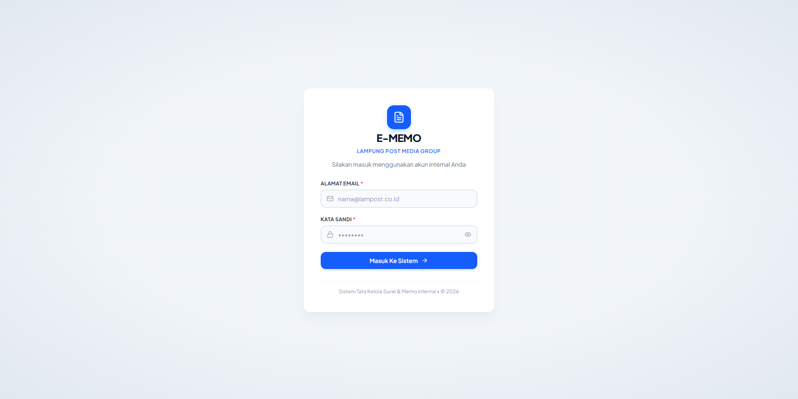
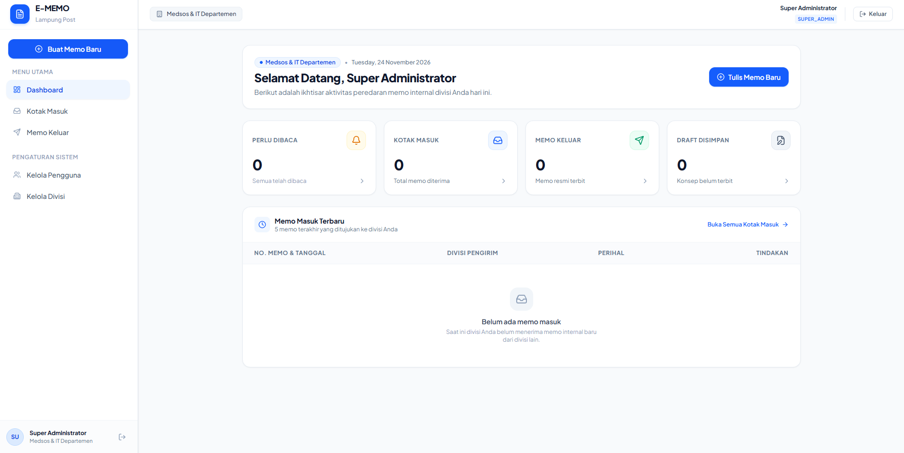
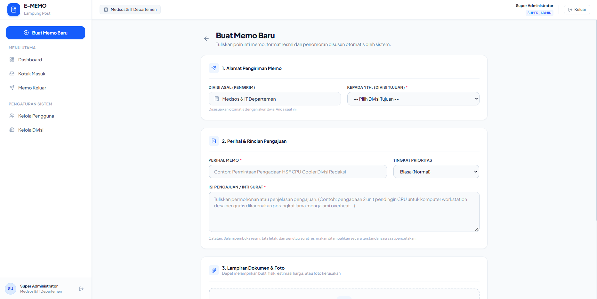
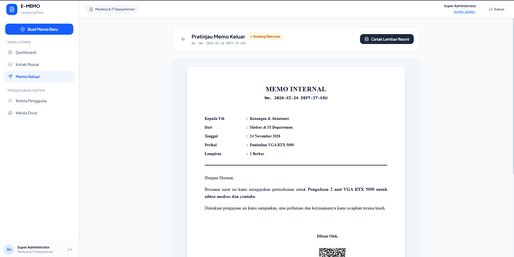
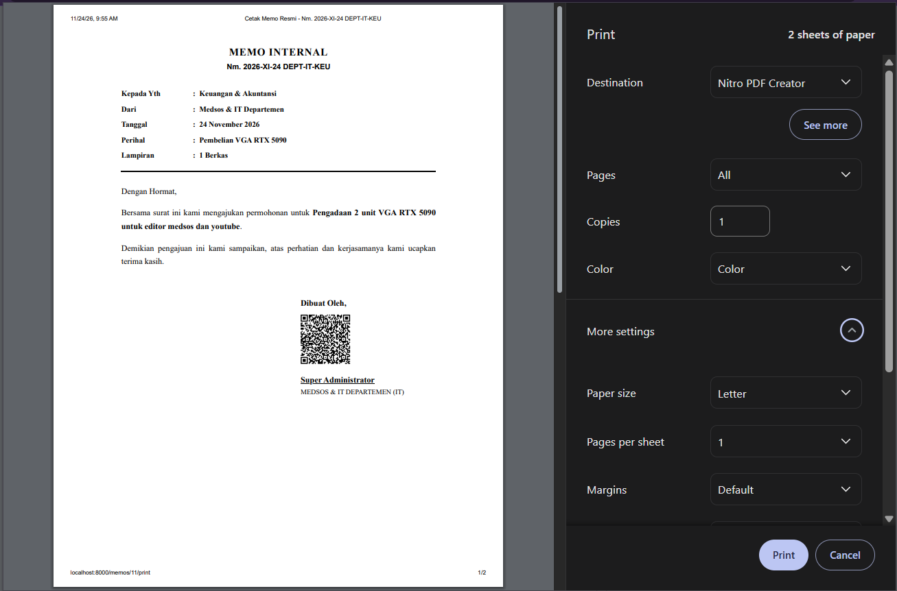
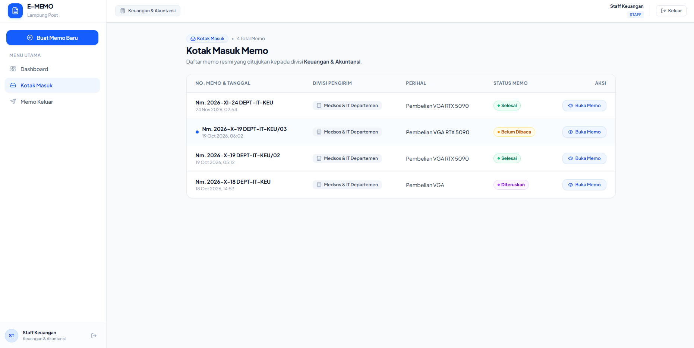
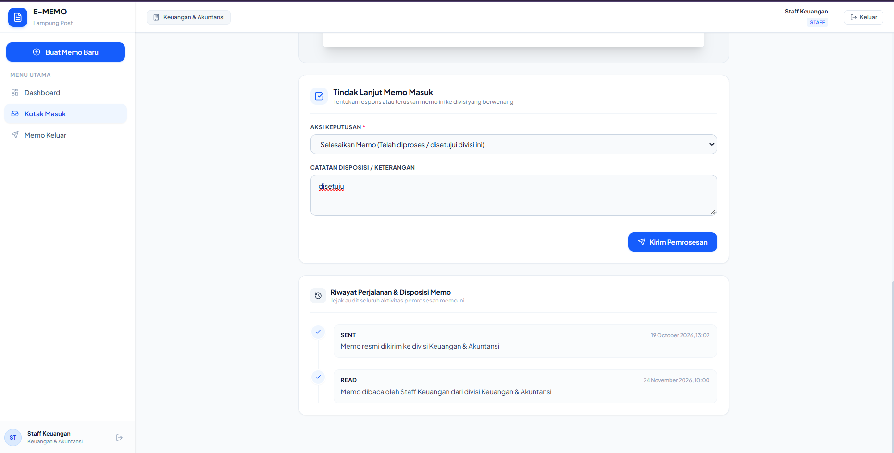
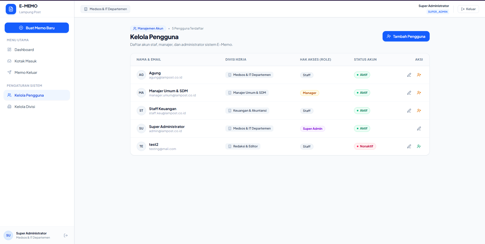

# Internal Memo Lampung Post

Sistem informasi berbasis web untuk mendigitalisasi alur pembuatan, pengiriman, penerimaan, penerusan (*forwarding*), pelacakan (*audit trail*), dan pencetakan memo resmi antar divisi di lingkungan **Lampung Post**.

---

## Daftar Isi

- [Fitur Utama](#fitur-utama)
- [Preview Aplikasi](#preview-aplikasi)
- [Teknologi yang Digunakan](#teknologi-yang-digunakan)
- [Persyaratan Sistem](#persyaratan-sistem)
- [Instalasi & Konfigurasi Lokal](#instalasi--konfigurasi-lokal)
- [Akun Pengujian (Seeder)](#akun-pengujian-seeder)
- [Struktur Direktori Penting](#struktur-direktori-penting)
- [Aturan Bisnis & Penomoran](#aturan-bisnis--penomoran)

---

## Fitur Utama

1. **Autentikasi & Hak Akses Berbasis Peran (RBAC)**
   - Login dan manajemen sesi pengguna dengan pengecekan status aktif akun (`is_active`).
   - Proteksi rute menggunakan *middleware* peran (`super_admin`, `admin`, `manager`, `staff`).
   - Manajemen pengguna dan divisi secara internal oleh administrator (tanpa registrasi publik).
2. **Pembuatan Memo Cepat & Penomoran Otomatis**
   - Formulir ringkas: pengguna cukup mengisikan poin inti pengajuan, sedangkan paragraf pembuka dan penutup disusun otomatis sesuai format surat resmi.
   - Dukungan status **Draft** (dapat diedit dan dihapus) serta penerbitan resmi dengan pencegahan *double-submit*.
   - Generasi nomor memo otomatis saat dikirim dengan format `Nm. YYYY-MM(Romawi)-DD DEPT-asal-tujuan` yang dilengkapi transaksi database dan *pessimistic locking* (`lockForUpdate()`) untuk mencegah duplikasi nomor saat pengiriman bersamaan.
3. **Manajemen Lampiran & Live Preview**
   - Mendukung unggah banyak file/gambar sekaligus secara akumulatif dengan pratinjau langsung (*live preview*) dan opsi hapus sebelum maupun saat mengedit draft.
   - Lampiran gambar otomatis dirender pada halaman lanjutan (halaman 2 dan seterusnya) saat dicetak.
4. **Dokumen Cetak Standar A4 & QR Code Verifikasi**
   - Tata letak cetak/PDF berukuran A4 yang bersih tanpa *header/footer* bawaan browser.
   - Dilengkapi **QR Code** dinamis yang memuat data validasi penandatangan (nama, bagian/divisi, jabatan, perihal, dan tanggal penerbitan).
5. **Inbox, Forwarding, Audit Trail & Dashboard**
   - Divisi tujuan dapat menerima, membaca, menyelesaikan, atau meneruskan (*forward*) memo ke divisi lain beserta catatan tindak lanjut.
   - Setiap perubahan status dan perpindahan memo tercatat secara kronologis pada riwayat perjalanan memo (*audit trail*).
   - Dashboard menyajikan ringkasan statistik memo masuk, memo belum dibaca, memo terkirim, dan draft.

---

## Preview Aplikasi

### 1. Halaman Login


### 2. Dashboard Utama


### 3. Buat Memo & Live Preview Lampiran


### 4. Preview Dokumen A4 & Lampiran Halaman Lanjutan


### 5. Hasil Cetak / Simpan PDF (Dengan QR Code)


### 6. Inbox, Tindak Lanjut & Audit Trail



### 7. Manajemen Pengguna & Divisi (Admin)


---

## Teknologi yang Digunakan

- **Backend:** PHP 8.3+, Laravel Framework 13.x
- **Database:** MySQL
- **Frontend:** Blade Template, Tailwind CSS (Vite)
- **Ikon & Notifikasi:** Lucide Icons, SweetAlert2 (Toast Notification)
- **Generator QR Code:** `simplesoftwareio/simple-qrcode`

---

## Persyaratan Sistem

- PHP >= 8.3 (dengan ekstensi `gd` atau `imagick` aktif untuk pemrosesan QR Code)
- Composer
- Node.js & NPM
- MySQL / MariaDB

---

## Instalasi & Konfigurasi Lokal

1. **Clone repositori dan masuk ke direktori proyek**
```bash
git clone https://github.com/MadeRaditya/Internal_Memo-LampungPost.git
cd Internal_Memo-LampungPost
git checkout dev
```

2. **Install dependensi PHP dan JavaScript**
```bash
composer install
npm install

```


3. **Salin dan atur konfigurasi environment**
```bash
cp .env.example .env
php artisan key:generate

```


Sesuaikan konfigurasi database MySQL pada file `.env`:
```env
DB_CONNECTION=mysql
DB_HOST=127.0.0.1
DB_PORT=3306
DB_DATABASE=internal_memo
DB_USERNAME=root
DB_PASSWORD=

```


4. **Jalankan migrasi database, seeder, dan symbolic link storage**
```bash
php artisan migrate:fresh --seed
php artisan storage:link

```


5. **Jalankan server pengembangan**
Buka dua terminal terpisah untuk menjalankan server Laravel dan Vite:
```bash
# Terminal 1
php artisan serve

# Terminal 2
npm run dev

```


Akses aplikasi melalui browser di `http://localhost:8000`.

---

## Akun Pengujian (Seeder)

Setelah menjalankan `php artisan db:seed`, akun bawaan berikut dapat digunakan untuk pengujian lokal (kata sandi semua akun: `password`):

| Peran (*Role*) | Nama | Divisi | Email |
| --- | --- | --- | --- |
| **Super Admin** | Super Administrator | Medsos & IT Departemen | `admin@lampost.co.id` |
| **Staff** | Agung | Medsos & IT Departemen | `agung@lampost.co.id` |
| **Manager** | Manajer Umum & SDM | Manajer Umum & SDM | `manager.umum@lampost.co.id` |
| **Staff** | Staff Keuangan | Keuangan & Akuntansi | `staff.keu@lampost.co.id` |

---

## Struktur Direktori Penting

```text
├── app/
│   ├── Http/
│   │   ├── Controllers/
│   │   │   ├── Auth/LoginController.php
│   │   │   ├── DashboardController.php
│   │   │   ├── DepartmentController.php
│   │   │   ├── InboxController.php
│   │   │   ├── MemoController.php
│   │   │   └── UserController.php
│   │   ├── Middleware/RoleMiddleware.php
│   │   └── Requests/StoreMemoRequest.php
│   ├── Models/
│   │   ├── Department.php
│   │   ├── Memo.php
│   │   ├── MemoAttachment.php
│   │   ├── MemoHistory.php
│   │   ├── MemoRecipient.php
│   │   └── User.php
│   ├── Policies/MemoPolicy.php
│   └── Services/MemoNumberService.php
├── database/
│   ├── migrations/
│   └── seeders/
├── resources/views/
│   ├── auth/
│   ├── departments/
│   ├── inbox/
│   ├── layouts/app.blade.php
│   ├── memos/
│   ├── users/
│   └── dashboard.blade.php
└── routes/web.php

```

---

## Aturan Bisnis & Penomoran

* **Status Draft vs Resmi:** Memo berstatus `draft` tidak memiliki nomor surat, tidak tampil pada inbox maupun statistik divisi tujuan, serta masih dapat diubah atau dihapus oleh pembuatnya.
* **Integritas Dokumen Resmi:** Memo yang sudah diterbitkan tidak dapat ditarik kembali atau dihapus untuk menjaga keutuhan arsip dan urutan penomoran.
* **Penerusan (*Forwarding*):** Memo yang diteruskan ke divisi lain tetap mempertahankan nomor memo induk yang sama, namun mencatat alur penerima baru dan riwayat tindakan secara terpisah di audit trail.

---
